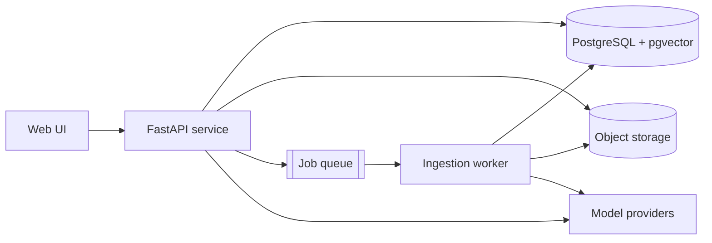
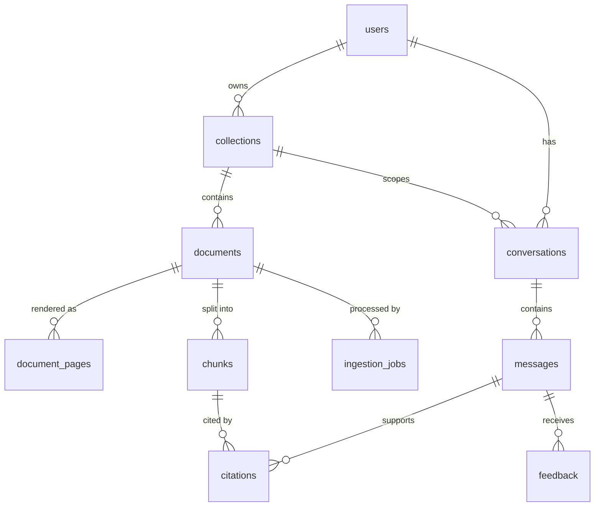

# Architecture

## Components

Implemented today: the API service and the PostgreSQL schema. The other components
are listed in the README status table and arrive in later milestones.

## Data model

| Table | Purpose |
|---|---|
| `collections` | Retrieval scope. Every search is filtered to one collection. |
| `documents` | One uploaded file. Unique on `(collection_id, sha256)`, so re-uploading is idempotent. |
| `document_pages` | Rendered page images, used to show a cited region. |
| `chunks` | Unit of retrieval: text passage, table, or figure. Holds the dense embedding, a generated full-text vector, page number and bounding box. |
| `ingestion_jobs` | Processing state per document, with stage, attempts and error. |
| `messages` | Conversation turns, with model, token usage, latency, trace id, and whether the assistant abstained. |
| `citations` | One row per cited claim: message, chunk, marker, quoted span, support score. |
| `feedback` | Thumbs up/down per message. |
| `eval_runs` | Offline evaluation results per commit. |

### Search indexes on `chunks`

- `embedding vector(1024)` with an HNSW index using cosine distance.
- `search_vector`, a stored generated `tsvector` over the chunk's context and content,
  with a GIN index.
- `collection_id` is denormalised onto chunks so the filtered search needs no join.

The embedding dimension is a schema constant (`EMBEDDING_DIMENSIONS`). Switching to a
model with a different dimension is a migration plus a re-embed, by design: mixing
vectors from different models in one index silently degrades retrieval.

### Deletion

All foreign keys cascade. Deleting a document removes its pages, chunks and the
citations that pointed at them; deleting a user removes their collections and
conversations. A unit test enforces this for every foreign key.

## Operations

- `GET /healthz`: liveness, no dependencies touched.
- `GET /readyz`: readiness; verifies the database is reachable and pgvector is installed.
- Every response carries `X-Request-ID`; the same id is attached to each log line.
- Logs are JSON in containers, plain text locally.
- Migrations run as a one-shot container before the API starts.
