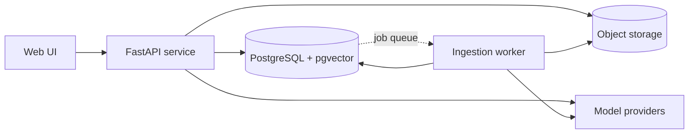
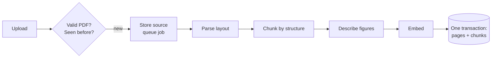
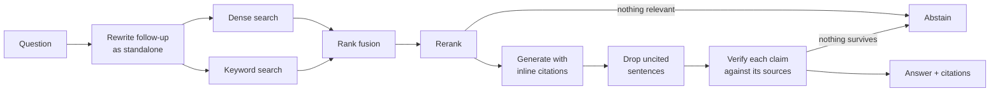
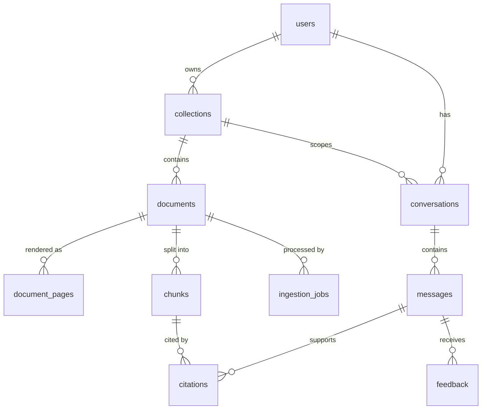

# Architecture

## Components

Implemented today: the API service, the PostgreSQL schema and the ingestion worker.
The other components are listed in the README status table and arrive in later
milestones.

## Ingestion

1. **Accept.** A file is checked by content (not extension), size-limited, and hashed.
   The same bytes uploaded to the same collection return the existing document.
2. **Parse.** A layout model recovers reading order, headings, tables and figures, with
   the page and bounding box of every block. Tables are kept as Markdown; tables and
   figures also keep a cropped image. Each page is rendered for the citation viewer.
3. **Chunk.** Text is grouped under its heading and never merged across a section
   boundary; oversized blocks split at sentence boundaries. Every table and figure is a
   chunk of its own. Each chunk records the heading path above it and the page regions
   it covers.
4. **Describe figures.** A vision model transcribes what is visible in each figure and
   is told not to infer beyond it. Decorative images are dropped. Without a vision
   model, a figure is indexed by its printed caption only.
5. **Embed.** The heading path is prepended to the content before embedding, so a
   passage is retrieved in the context of its section. The endpoint's vector size is
   verified against the index.
6. **Store.** Pages and chunks are written in one transaction that replaces any earlier
   result, so re-running ingestion is idempotent and readers never see a half-indexed
   document.

### Job queue

Jobs live in the `ingestion_jobs` table. Workers claim them with
`SELECT ... FOR UPDATE SKIP LOCKED`, so any number of workers can run without a
separate broker and without taking the same job twice. A failed job is retried up to a
limit; a job left running by a worker that died is reclaimed after a timeout.

### Model providers

The pipeline depends on two small interfaces, `Embedder` and `FigureDescriber`. The
bundled implementation speaks the OpenAI-compatible HTTP API, which covers hosted
providers and local servers alike, with bounded retries and backoff on transient
failures.

## Answering

1. **Standalone question.** A follow-up such as "how is it delivered?" is rewritten
   using the conversation so that search sees the full question.
2. **Hybrid search.** Dense search (pgvector, cosine) finds passages by meaning; keyword
   search (PostgreSQL full-text) finds exact terms, part numbers and names. Both run
   inside the collection only. The keyword query matches any term rather than all of
   them, because a natural question contains words its answer does not.
3. **Fusion.** Reciprocal rank fusion merges the two rankings by position, which needs
   no score calibration and favours passages both searches agree on.
4. **Rerank (optional).** A cross-encoder rescoring step, with a cut-off below which
   candidates are discarded.
5. **Generate.** The model sees numbered sources and must end every sentence with the
   sources that support it, or reply that the answer is not present. Source text is
   presented as material to quote, not instructions to follow.
6. **Enforce.** Citations that point outside the provided sources are ignored, and any
   sentence left without a valid citation is deleted.
7. **Verify.** A second pass checks each remaining sentence against the sources it
   cites and removes those that are not supported. If the check itself fails, the
   answer is returned flagged as unverified rather than silently trusted.
8. **Abstain.** No retrieved passages, a refusal from the model, or no surviving
   sentence all produce the same explicit "not in the documents" reply.

Each answer is stored with its citations (chunk, marker, verification result), token
usage and latency.

## Data model

| Table | Purpose |
|---|---|
| `collections` | Retrieval scope. Every search is filtered to one collection. |
| `documents` | One uploaded file. Unique on `(collection_id, sha256)`, so re-uploading is idempotent. |
| `document_pages` | Rendered page images, used to show a cited region. |
| `chunks` | Unit of retrieval: text passage, table, or figure. Holds the dense embedding, a generated full-text vector, page number and bounding box. |
| `ingestion_jobs` | Processing state per document, with stage, attempts and error. |
| `messages` | Conversation turns, with model, token usage, latency, trace id, and whether the assistant abstained. |
| `citations` | One row per cited claim: message, chunk, marker, quoted span, support score. |
| `feedback` | Thumbs up/down per message. |
| `eval_runs` | Offline evaluation results per commit. |

### Search indexes on `chunks`

- `embedding vector(1024)` with an HNSW index using cosine distance.
- `search_vector`, a stored generated `tsvector` over the chunk's context and content,
  with a GIN index.
- `collection_id` is denormalised onto chunks so the filtered search needs no join.

The embedding dimension is a schema constant (`EMBEDDING_DIMENSIONS`). Switching to a
model with a different dimension is a migration plus a re-embed, by design: mixing
vectors from different models in one index silently degrades retrieval.

### Deletion

All foreign keys cascade. Deleting a document removes its pages, chunks and the
citations that pointed at them; deleting a user removes their collections and
conversations. A unit test enforces this for every foreign key.

## Operations

- `GET /healthz`: liveness, no dependencies touched.
- `GET /readyz`: readiness; verifies the database is reachable and pgvector is installed.
- Every response carries `X-Request-ID`; the same id is attached to each log line.
- Logs are JSON in containers, plain text locally.
- Migrations run as a one-shot container before the API starts.
